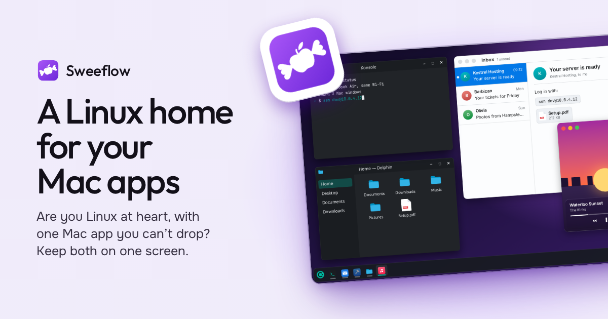

<div align="center">


# Sweeflow

### A Linux home for your Mac apps

Are you Linux at heart, with one Mac app you can't drop? Keep both on one screen.

[**Website**](https://sweeflow.app) · [**Download**](https://github.com/herunan/sweeflow/releases/latest) · [**Sponsor**](https://github.com/sponsors/herunan)

[](LICENSE)




</div>

## Why Sweeflow

You moved to Linux, but one app still keeps you on your Mac. So you switch screens all day, or you open a remote desktop with a whole Mac squeezed into one window.

Sweeflow seamlessly streams just the apps you need from your Mac to your Linux desktop. Each Mac window opens as its own window on Linux. It sits in your taskbar and moves, tiles and closes like your other windows.

## Features

- **Fast, sharp and smooth.** Up to 120 fps and Retina sharp.
- **Apps in launcher.** Your Mac apps show up in your launcher, next to your Linux apps.
- **Shared clipboard.** Copy on one, paste on the other.
- **Drag and drop files.** Move files between Mac windows and Linux.
- **Sound passthrough.** The Mac's sound plays on your Linux machine.
- **Global menu.** On KDE Plasma, the Mac app's menu bar sits in your panel.
- **Mac shortcuts.** Sweeflow maps your keys like a Mac. Super is ⌘ and Alt is ⌥. You choose which shortcuts stay with Linux.
- **Local, remote or VM.** Use a MacBook beside you, a Mac mini miles away over Tailscale, or a macOS VM on your PC.

## Tested on


Using another Linux flavour? Contributions to support it are welcome.

## Install

Sweeflow comes in two parts. The Mac host goes on your Mac and shares its windows. The Linux client goes on Linux and shows them.

### 1. Install the Mac host

[**Download Sweeflow for Mac**](https://github.com/herunan/sweeflow/releases/latest/download/Sweeflow.dmg) and drag it to Applications. It needs macOS 15 or later.

Open it and allow all permissions. Then go to the **Link a Linux machine** screen.

### 2. Install the Linux client

**Any distro**

```sh
curl -fsSL https://github.com/herunan/sweeflow/releases/latest/download/install.sh | sh
```

**Arch and CachyOS**

Add Sweeflow's repo once.

```sh
curl -fsSL https://github.com/herunan/sweeflow/releases/latest/download/sweeflow.asc | sudo pacman-key --add -
sudo pacman-key --lsign-key E1D31233BB01463B575ACD5E387237FAEFBBB7B8
printf '\n[sweeflow]\nServer = https://github.com/herunan/sweeflow/releases/latest/download\n' | sudo tee -a /etc/pacman.conf
```

Then install it. It updates with the rest of your system.

```sh
sudo pacman -Syu sweeflow
```

**Omarchy**

Add the repo as above, then install with `sudo pacman -Sy sweeflow`. Omarchy's own updates keep it up to date.

Sweeflow is also an Omarchy plugin: its icon in the bar and a panel in Omarchy's own look, with your Mac's apps, Pause, Stop and Start, and the settings.

```sh
omarchy plugin add https://github.com/herunan/sweeflow.git --enable
```

The plugin is the panel only. Without Sweeflow installed it shows the steps above. Remove it with `omarchy plugin remove io.github.herunan.sweeflow`.

**Debian, Ubuntu and Mint**

Add Sweeflow's repo once.

```sh
curl -fsSL https://github.com/herunan/sweeflow/releases/latest/download/sweeflow.asc | sudo gpg --dearmor -o /usr/share/keyrings/sweeflow.gpg
echo "deb [signed-by=/usr/share/keyrings/sweeflow.gpg] https://github.com/herunan/sweeflow/releases/latest/download ./" | sudo tee /etc/apt/sources.list.d/sweeflow.list
```

Then install it. It updates with the rest of your system.

```sh
sudo apt update && sudo apt install sweeflow
```

### 3. Link them

Open **Sweeflow** from your app menu. It shows **Link a Mac**. Choose your Mac and type the code it shows. Your Mac apps then appear in your launcher.

## How it works

The Mac host captures each window and sends it as video. The Linux client shows each one as a window of its own. Everything travels over QUIC and is encrypted. Each computer's certificate is pinned when you link them.

The details are in [PROTOCOL.md](PROTOCOL.md).

## Build from source

```sh
# Linux client (Rust)
cd linux && cargo build --release && ./target/release/sweeflow install

# Mac host (Swift, on a Mac)
cd mac && ./install.sh
```

## Support

Sweeflow is free and open source under the [MIT licence](LICENSE). If it's useful to you, you can help keep it going.

[](https://github.com/sponsors/herunan)
[](https://ko-fi.com/herunan)

Thank you!

<sub>Mac and macOS are trademarks of Apple Inc. Sweeflow is not affiliated with Apple.</sub>
